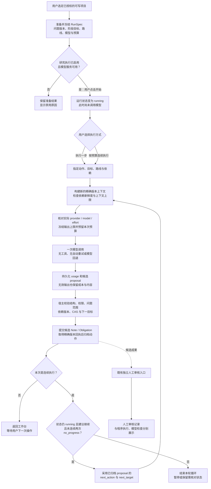
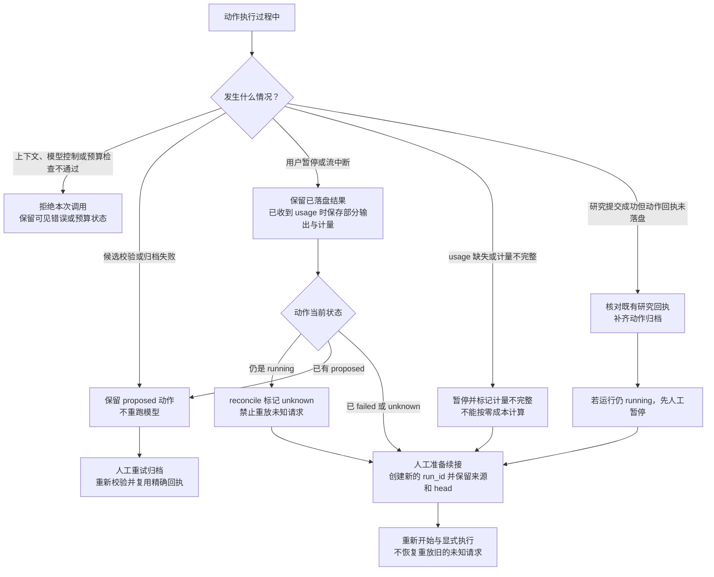

# 当前数学研究 workflow（dsh-math 0.11.0）

本图描述当前实现，源码基线为 `613b6bb61fa7a3b4385fe3e5a14cde0f458dcfc3`，核对日期 2026-11-03。流程以**固定模型、有限预算、精确版本上下文、可恢复的候选成果归档**为中心。它不是未来功能路线图，也不表示已经证明数学能力提升。

GitHub 可直接渲染下方 Mermaid 图。[交互流程图 HTML](current-workflow.html) 下载后可在浏览器打开；GitHub 文件页面不会直接运行 HTML。[可编辑图规格](candidate.json)供后续维护。[Math agent 参考来源与设计取舍](harness-influences.md)说明各机制的来源、目的和实现边界。

## 1. 主流程

准备、开始和执行是三个不同阶段。准备不会调用模型；开始只改变运行状态；只有用户明确执行一步或连续执行才发送请求。连续循环不会自动选择新路线，它沿用当前路线并读取已归档候选的下一动作建议。

## 2. 暂停、错误与恢复

`reconcile` 对已有 proposed 成果只核对并归档已存在的精确研究回执；它不会借核对操作新写一份研究成果。`continue` 创建新的运行，旧运行及未知结果保留。暂停不保证提供方已立即终止计费，因此中断后的不确定计量不会被抹掉。

## 3. 模型实际可以做什么

| 动作 | 当前行为 | 结论边界 |
|---|---|---|
| `derive` 推导 | 针对冻结目标提出论证 | 归档为候选笔记 |
| `check` 检查 | 用新上下文检查命题及依据 | 是模型意见，不是形式化证书 |
| `revise` 修订 | 针对问题修订候选内容 | 必须通过精确版本与依赖校验 |
| `decompose` 拆分 | 提出待证事项和关系 | 只允许 Note / Obligation |
| `reconstruct` 盲重建 | 隐藏目标原证明正文，尝试从允许的前提重建 | 失败表示不确定；连续循环不会自行建议此动作 |
| `stop` 结束操作 | 暂停，不调用模型 | 不表示问题已解决 |

模型不能写入人工 Review、改写 Problem 或授予自身权限。当前 worker 无文献检索、代码执行或通用 checker 工具；已有程序检查、模型意见、依赖新鲜度与人工接受分别投影。验证复用是建议，不会自动跳过检查。普通聊天的自动记录入口与此运行控制保持独立。

## 4. 职责划分与源码依据

| 层 | 职责 | 源码 |
|---|---|---|
| 工作台与宿主 | 人工操作、执行开关、会话授权、暂停请求 | [workflow-ui.cjs](../../workflow-ui.cjs)、[host.mjs](../../host.mjs) |
| 策略与运行状态 | 冻结配置、预算预留、动作状态、核对和续接；展示路线重评建议 | [workflow_store.py](../../workflow_store.py)、[workflow_strategy.py](../../workflow_strategy.py) |
| 执行与上下文 | 单次调用、串行循环、新上下文、盲重建隔离 | [workflow_runner.mjs](../../workflow_runner.mjs)、[workflow_context.py](../../workflow_context.py) |
| 成果提交 | 结构校验、精确引用、版本冲突、研究回执恢复 | [workflow_service.py](../../workflow_service.py) |

完整约束见[流程协议](../../contracts/workflow-v1.md)。下一步能力比较按[评测契约](../../contracts/workflow-evaluation-v1.md)执行；工程流程通过验收不等于数学正确率或研究效率已经提高。
